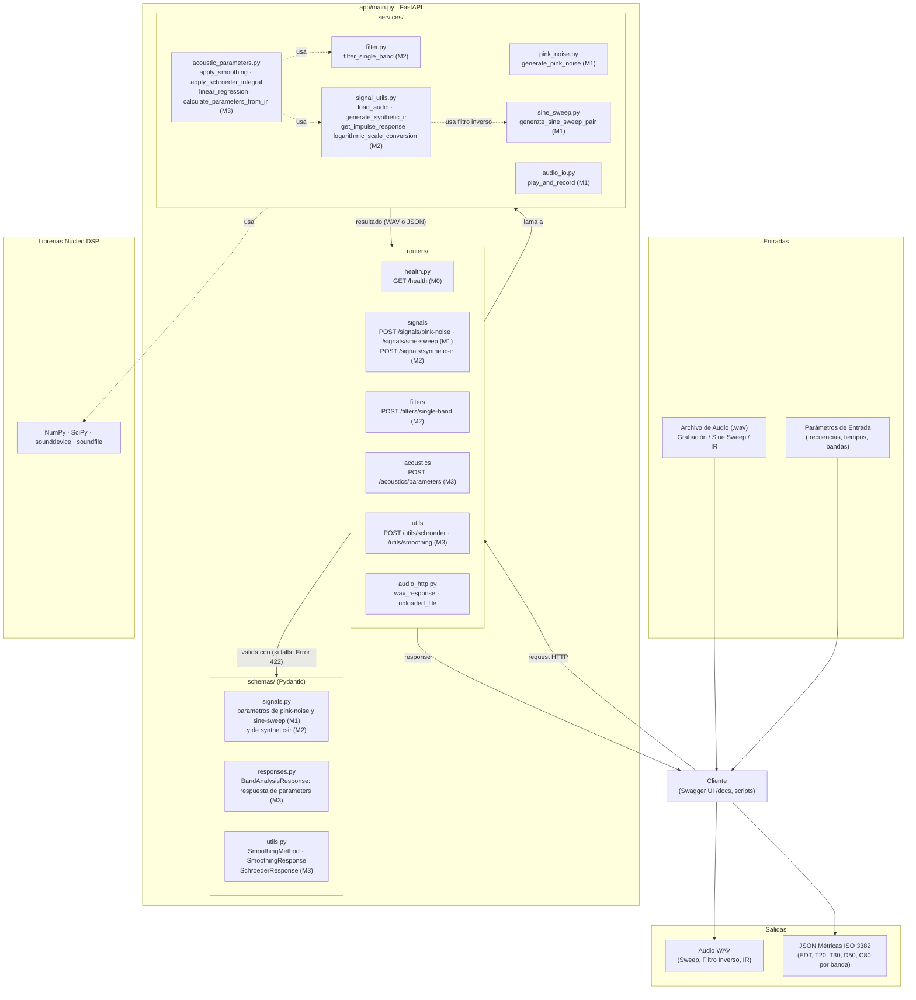
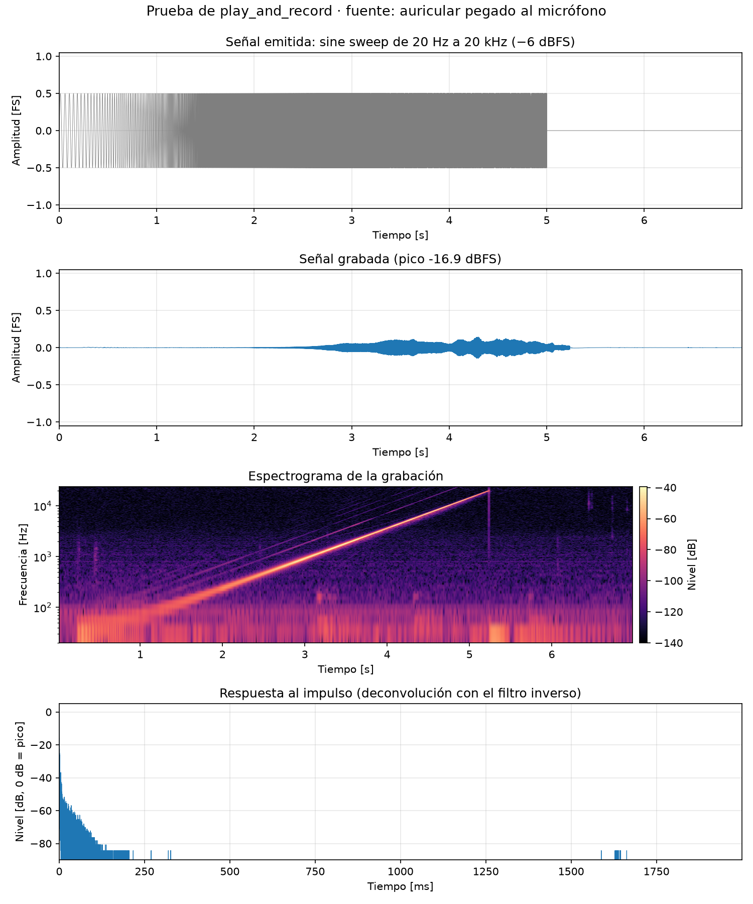
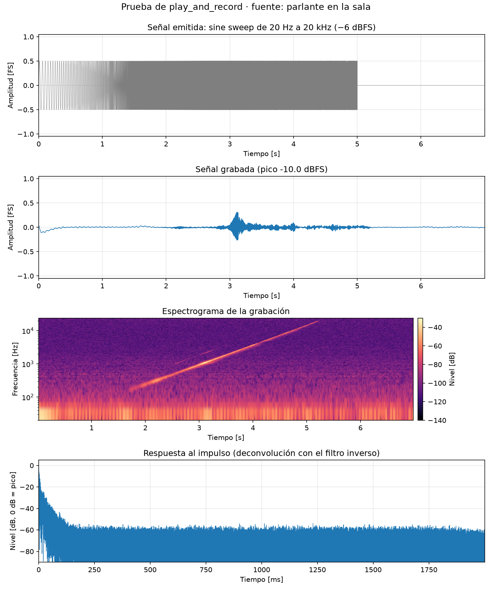
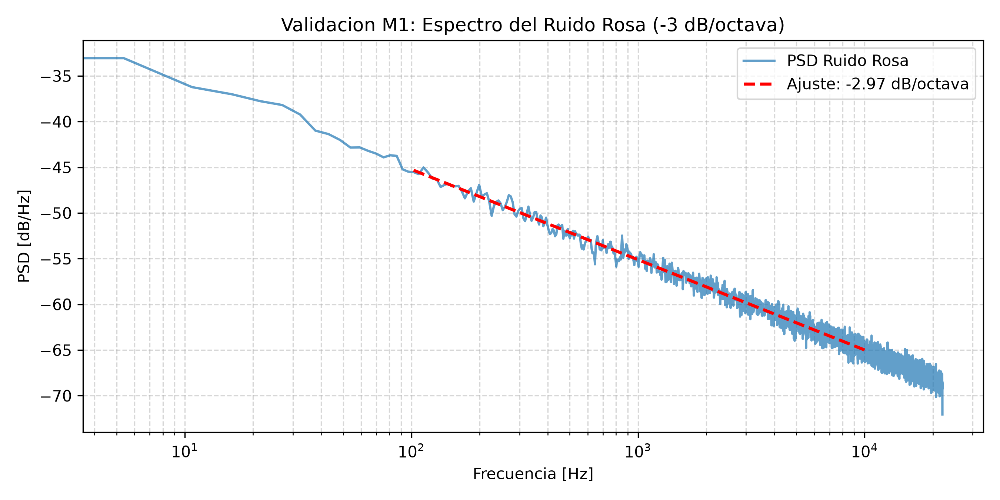
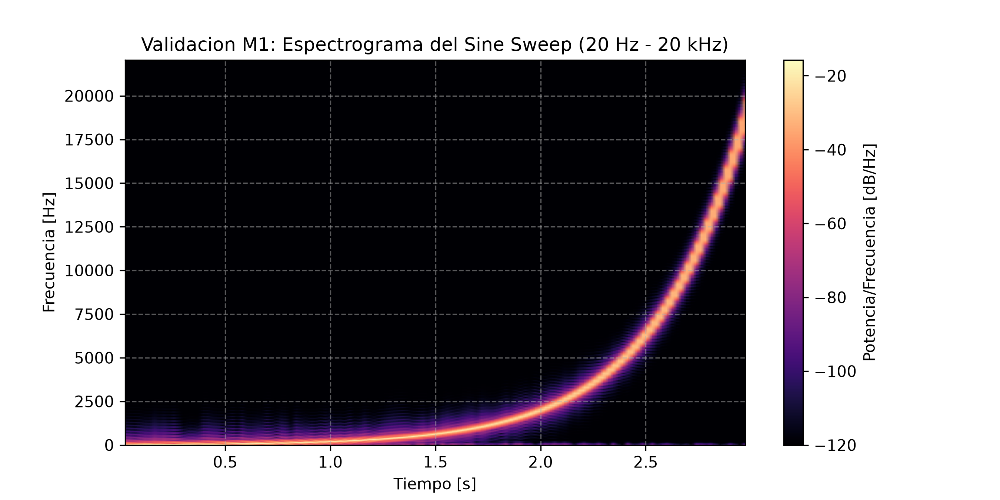
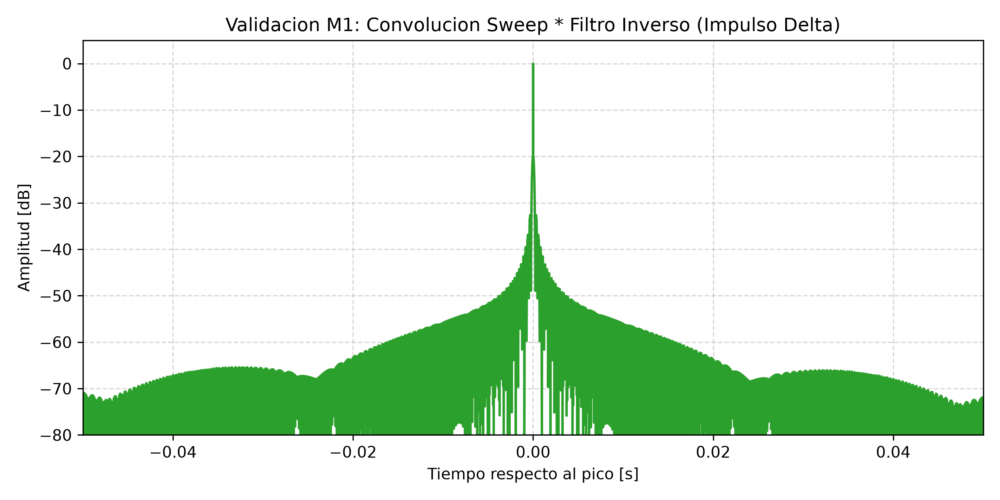
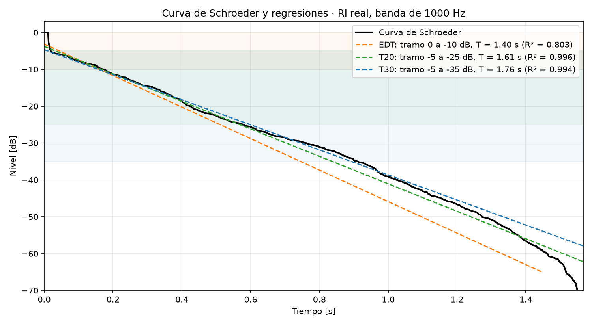
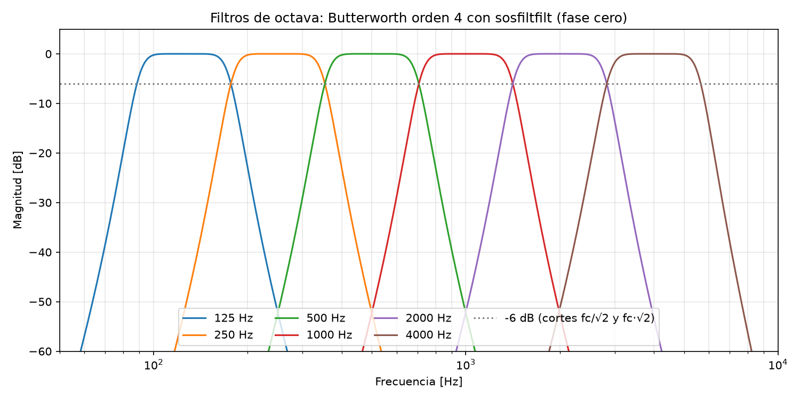
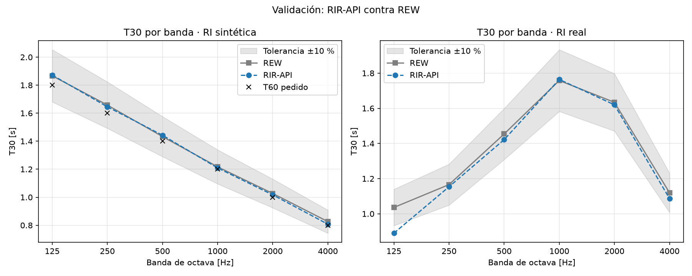

# RIR-API

API REST para procesamiento y analisis de respuestas al impulso segun la norma ISO 3382.


## Descripcion

RIR-API es el trabajo practico de Senales y Sistemas (UNTREF, 2C 2026): una API REST
(FastAPI) con la cadena completa de procesamiento acustico, desde la generacion de senales
de excitacion hasta el calculo de parametros acusticos (EDT, T20, T30, D50, C80) segun
ISO 3382-1.

- Consigna, especificaciones y ruta del TP: <https://maxiyommi.github.io/signal-systems/trabajo_practico/ruta/>
- API de referencia de la catedra (Swagger UI): <https://rir-api.onrender.com/docs>


## Integrantes

| Nombre | Legajo | Rol |
|--------|--------|-----|
| Leonardo Valle | 76106 | Integración, API, adquisición de audio y cálculo de parámetros |
| Matías Archelli | 70479 | Ruido rosa, filtrado y curva de decaimiento; registro de IA |
| Marcelo Flores | 50004 | Sine sweep, respuesta al impulso y validación |

## Requisitos previos

- Python 3.12 o superior
- [uv](https://docs.astral.sh/uv/) (gestor de paquetes y entornos virtuales)
- git y una cuenta de GitHub

## Arranque 
Clonar el repositorio e instalar (ver "Instalacion y ejecucion"):

    git clone https://github.com/leonardofvalle/rir-api.git
    cd rir-api

## Instalacion y ejecucion

```bash
# Crear el entorno e instalar dependencias (incluye las de desarrollo: pytest, ruff, ...)
uv sync

# Iniciar la API con hot-reload
uv run uvicorn app.main:app --reload

# Correr los tests
uv run pytest
```

La API queda disponible en `http://localhost:8000`. Documentacion interactiva:

- Swagger UI: `http://localhost:8000/docs`
- ReDoc: `http://localhost:8000/redoc`


## Estructura del proyecto

```
rir-api/
├── app/
│   ├── __init__.py
│   ├── main.py                    # Punto de entrada FastAPI (/ y /health)
│   ├── settings.py                # Configuracion (pydantic-settings, variables RIR_*)
│   ├── routers/
│   │   ├── __init__.py
│   │   ├── health.py              # GET /health (M0)
│   │   ├── audio_http.py          # wav_response y uploaded_file (ya resueltas)
│   │   ├── signals.py             # Endpoints de generación de señales (M1)
│   │   ├── filters.py             # Endpoints de filtrado por bandas de octava (M2)
│   │   ├── utils.py               # Endpoints de utilidades: envolvente y curva de Schroeder (M3)
│   │   └── acoustics.py           # Endpoint de parametros acusticos ISO 3382 por banda (M3)
│   ├── schemas/
│   │   ├── __init__.py            # Modelos Pydantic de request/response (desde M1)
│   │   ├── signals.py             # Generación de senales (M1)
│   │   ├── utils.py               # Endpoints de utilidades (M3)
│   │   └── responses.py           # Respuestas del analisis acustico (M3)
│   └── services/
│       ├── __init__.py
│       ├── pink_noise.py          # generate_pink_noise (M1)
│       ├── sine_sweep.py          # generate_sine_sweep_pair (M1)
│       ├── audio_io.py            # play_and_record (M1)
│       ├── signal_utils.py        # load_audio, generate_synthetic_ir, get_impulse_response,
│       │                          # logarithmic_scale_conversion (M2)
│       ├── filter.py              # filter_single_band (M2)
│       └── acoustic_parameters.py # apply_smoothing, apply_schroeder_integral, linear_regression,
│                                  # calculate_parameters_from_ir, apply_lundeby (M3)
├── tests/
│   ├── data/                      # WAV chicos de prueba (se versionan)
│   ├── test_placeholder.py        # Test trivial (M0)
│   ├── test_generacion.py         # Tests de M1
│   ├── test_procesamiento.py      # Tests de M2
│   ├── test_analisis.py           # Tests de M3 (services)
│   ├── test_api.py                # Tests de endpoints, por milestone (M0 a M3)
│   ├── test_api_errores.py        # Tests de endpoints de M3
│   └── test_parametros_bordes.py  # Tests de M3 para calculate_parameters_from_ir
├── data/                          # Mediciones y audios locales (ignorado por git)
├── docs/
│   ├── m1/                        # Gráficos de validación de M1
│   │   ├── convolucion_sweep_filtro_inverso.png
│   │   ├── espectro_ruido_rosa.png
│   │   ├── espectrograma_sine_sweep.png
│   │   ├── prueba_auricular.png
│   │   ├── prueba_auricular_grabacion.wav
│   │   ├── prueba_auricular_ri.wav
│   │   ├── prueba_parlante.png
│   │   ├── prueba_parlante_grabacion.wav
│   │   └── prueba_parlante_ri.wav
│   ├── m2/                        # Gráficos de validación de M2
│   │   ├── README.md              # Resumen de la validación experimental
│   │   ├── decaimiento_bandas_octava.png
│   │   ├── ida_y_vuelta_sintetica_correlacion.png
│   │   ├── rir_corta_analisis.png
│   │   └── rir_larga_analisis.png
│   ├── m3/                        # Gráficos de validación de M3
│   │   ├── filtros_octava.png
│   │   ├── schroeder_regresiones.png
│   │   ├── validacion_rew.png
│   │   ├── ri_real.wav
│   │   ├── ri_sintetica.wav
│   │   ├── rew.csv
│   │   └── tabla_validacion.md
│   └── README.md                  # Guia para la documentacion (graficas de validacion, etc.)
├── .github/workflows/ci.yml       # CI: ruff + pytest en cada push/PR
├── .gitignore
├── pyproject.toml                 # Dependencias y configuracion (ruff, pytest)
├── uv.lock                        # Gestión de dependencia utilizadas en el proyecto
├── AI_LOG.md                      # Registro del uso de IA
├── generar_graficas.py
├── generar_evidencias_m2.py
├── scripts/
│   ├── prueba_play_and_record.py  # Prueba real de play_and_record (M1)
│   └── graficar_prueba_real.py    # Grafico de cada prueba (M1)
├── generar_graficas_m3.py
└── README.md
```

Cada milestone expone lo que construye: los routers y schemas de `signals` se agregan en M1
(y suman `synthetic-ir` en M2), los de `filters` en M2 y los de `acoustics` y `utils` en M3
(ver los `TODO` en `app/main.py`).

## Arquitectura

La API se organiza en tres capas: los **routers** reciben los pedidos HTTP, los
**schemas** (Pydantic) validan los datos de entrada y salida, y los **services**
hacen el procesamiento de señales.



**Flujo de un pedido:** el cliente envía un request → el router lo recibe → Pydantic
valida los parámetros (si son inválidos responde con error 422) → el router llama al
service correspondiente → el resultado vuelve al cliente como WAV o JSON.

## Branching strategy

- **`main` protegida**: solo se modifica mediante pull request, con el CI
  (`lint-and-test`: ruff + pytest) en verde. No se permite push directo ni force push.
- **Ramas de trabajo**: una por tarea, creadas desde `main` actualizada:
  `feature/descripcion` para funcionalidades, `fix/descripcion` para correcciones y
  `docs/descripcion` para documentación (por ejemplo `feature/pink-noise`).
- **Commits**: siguiendo [Conventional Commits](https://www.conventionalcommits.org/):
  `feat:` funcionalidad nueva, `fix:` corrección, `docs:` documentación,
  `test:` tests, `refactor:` reorganización sin cambiar comportamiento, `chore:` mantenimiento.
- **Pull requests**: cada PR referencia su issue (por ejemplo "Closes #3") y lo revisa
  otro integrante antes del merge.
- **Entregas**: cada milestone se marca con un tag anotado en `main`
  (`v0.1.0`, `v0.2.0`, `v1.0.0`).

## Milestones y entregas (2C 2026)

| Milestone | Entrega | Tag | Evaluacion |
|-----------|---------|-----|------------|
| **M0 · El plano** (arquitectura) | mie 7/10 (asincronica, por Slack/GitHub) | — | Seguimiento, sin nota |
| **M1 · Generacion de senales** | mie 28/10 (en clase) | `v0.1.0` | Seguimiento, sin nota |
| **M2 · Procesamiento de la RI** | mie 4/11 | `v0.2.0` | Seguimiento, sin nota |
| **M3 · Producto final** + presentacion oral | mie 18/11 | `v1.0.0` | **Nota del TP: 60 % M3 + 40 % oral** |

- No hay informe escrito: la validacion de resultados va en una seccion **"Validacion"** de
  este README.
- **`AI_LOG.md`** en la raiz del repositorio es **obligatorio** (sin nota propia, pero sin
  `AI_LOG.md` M3 no se considera completo): registren el uso de herramientas de IA durante
  todo el proyecto.
- Detalle de cada milestone: <https://maxiyommi.github.io/signal-systems/trabajo_practico/ruta/>

### M0 · El plano

- [X] Repositorio del grupo creado a partir del template, con los docentes como colaboradores.
- [X] `uv sync`, `uv run uvicorn app.main:app --reload` y `uv run pytest` funcionan.
- [X] README con integrantes y roles, instalacion, estructura y branching strategy.
- [X] Diagrama de arquitectura (Mermaid o draw.io) con todos los modulos de M1, M2 y M3.
- [X] Al menos 10 issues con labels (`milestone-1`, `milestone-2`, `milestone-3`) y asignados.

### M1 · Generacion de senales (`v0.1.0`)

- [x] `generate_pink_noise()` en `app/services/pink_noise.py` (Filtrado de ruido blanco con H(f) = 1/√f).
- [x] `generate_sine_sweep_pair()` (sweep + filtro inverso) en `app/services/sine_sweep.py`.
- [x] `play_and_record()` en `app/services/audio_io.py`.
- [x] Endpoints `POST /api/v1/signals/pink-noise` y `POST /api/v1/signals/sine-sweep` (devuelven WAV),
      con sus schemas en `app/schemas/signals.py`.
- [x] Tests de `tests/test_generacion.py` y los de M1 en `tests/test_api.py` pasando;
      graficas de validacion en `docs/m1/`.

---

#### Prueba real de `play_and_record`

Dos pruebas con un sine sweep de 5 s (20 Hz a 20 kHz, −6 dBFS) y una grabación de 7 s. Los archivos están en `docs/m1/`: para cada prueba, la grabación (`prueba_<fuente>_grabacion.wav`, mono, 48 kHz), la RI obtenida (`prueba_<fuente>_ri.wav`) y el gráfico (`prueba_<fuente>.png`).

| Parámetro | Valor |
|---|---|
| Interfaz | Behringer UMC22 (USB Audio CODEC) |
| Micrófono | Audio-Technica AT2020 (phantom +48 V) |
| API de audio | MME (Windows) |
| Canales | 1 reproducido, 1 grabado (mono) |
| fs | 48000 Hz |
| Latencia informada | 180 ms entrada / 180 ms salida |

Cada gráfico muestra la señal emitida y la grabada en el mismo eje de tiempo, el espectrograma de la grabación y la RI obtenida por deconvolución.

#### Prueba 1: auricular

Auricular conectado a la salida PHONES de la UMC22 (canal izquierdo), pegado al micrófono. Pico de la grabación: −16,9 dBFS.



Muestra que la cadena funciona: placa, reproducción y grabación sincronizadas, sin clipping, con unos 0,2 s de latencia entre la señal emitida y la grabada. El auricular casi no reproduce graves (el barrido aparece arriba de unos 80 Hz), se ven armónicos de distorsión como líneas paralelas al barrido y un clic al terminar el sweep. La RI cae al piso de ruido en unos 200 ms: es la respuesta del auricular, no de la sala, porque el auricular no la excita.

#### Prueba 2: parlante

Parlantes integrados del monitor ASUS VG249QL3A (salida de audio NVIDIA por HDMI), con el micrófono a unos 20 cm, apuntando a los parlantes (en la parte trasera del monitor). Volumen del monitor 30 %, ganancia del micrófono a 1/4. Pico de la grabación: −10 dBFS.



Es la prueba que excita la sala y la que conecta con M2 y M3. El parlante del monitor no reproduce por debajo de unos 150 Hz (el barrido aparece recién ahí) y hay ruido de baja frecuencia (debajo de 60 Hz) durante toda la grabación. La RI cae unos 55 dB en unos 150 ms y después queda en el piso de ruido, cerca de −58 dB. Con el micrófono a 20 cm domina el sonido directo: para medir la sala según ISO 3382 harían falta una fuente omnidireccional, más distancia y fuente y micrófono fijos en soportes.

**Reproducir las pruebas** (desde la raíz del repositorio; los números de dispositivo se configuran al principio del script y cambian según lo que esté conectado, ver `uv run python -m sounddevice`):

```bash
uv run python -m scripts.prueba_play_and_record parlante
uv run python -m scripts.graficar_prueba_real parlante
```
### M2 · Procesamiento de la RI (`v0.2.0`)

- [x] `load_audio()`, `generate_synthetic_ir()`, `get_impulse_response()` y
      `logarithmic_scale_conversion()` en `app/services/signal_utils.py`.
- [x] `filter_single_band()` en `app/services/filter.py`.
- [x] Endpoints `POST /api/v1/signals/synthetic-ir` y `POST /api/v1/filters/single-band`
      (recibe un WAV subido).
- [x] Tests de `tests/test_procesamiento.py` y los de M2 en `tests/test_api.py` pasando.

### M3 · Producto final (`v1.0.0`)

- [x] `apply_smoothing()`, `apply_schroeder_integral()`, `linear_regression()` y
      `calculate_parameters_from_ir()` en `app/services/acoustic_parameters.py`.
- [x] Endpoints `POST /api/v1/acoustics/parameters`, `POST /api/v1/utils/schroeder` y
      `POST /api/v1/utils/smoothing`: la API completa.
- [x] Tests de `tests/test_analisis.py` y todos los de `tests/test_api.py` pasando.
- [x] Seccion "Validacion" en este README, `AI_LOG.md` y presentacion oral.
- [ ] (Opcional) `apply_lundeby()`.

## Tests

Las funciones de `app/services/` vienen como *stubs* que lanzan `NotImplementedError`. Sus
tests estan marcados como `xfail` (fallo esperado), asi el CI queda en verde desde el
primer dia:

- Mientras la funcion no este implementada, el test aparece como `x` (xfailed).
- Cuando la implementen bien, aparece como `X` (xpassed). En ese momento conviene **borrar
  la marca `xfail`** del modulo de tests (`pytestmark = ...`) para que el test cuente como
  un test normal. En `tests/test_api.py` la marca va test por test (`@xfail_m1`,
  `@xfail_m2`, `@xfail_m3`): borren la de cada endpoint que implementen.
- Si la implementacion es incorrecta, el test **falla** (rojo) con el `AssertionError`.

```bash
uv run pytest                                  # todos los tests
uv run pytest -v tests/test_generacion.py      # un archivo, con detalle
uv run pytest -v -k pink_noise                 # tests cuyo nombre contiene "pink_noise"
uv run pytest -rxX                             # listar xfailed / xpassed
uv run pytest --cov=app                        # con cobertura
```

`play_and_record` se testea con un *mock* de `sounddevice`, por lo que el CI no necesita
placa de audio. Para probarla de verdad, corran la funcion localmente con un parlante y un
microfono y documenten la configuracion (dispositivo, canales, fs, buffer size).

## Linter y formato

```bash
uv run ruff check app/ tests/          # verificar estilo
uv run ruff check --fix app/ tests/    # corregir lo automatico
uv run ruff format app/ tests/         # formatear
```

El CI (`.github/workflows/ci.yml`) corre `ruff check`, `ruff format --check` y
`pytest --cov=app` en cada push a `main` y en cada pull request.

## Configuracion

`app/settings.py` define la configuracion con `pydantic-settings`. Cualquier valor se puede
sobreescribir con variables de entorno con prefijo `RIR_` (por ejemplo `RIR_FS_DEFAULT=44100`)
o con un archivo `.env` en la raiz (ignorado por git).

## Validación y Evidencia Gráfica


### Milestone 1: Generación de Señales 

Las imágenes de validación se encuentran almacenadas en la carpeta `docs/m1/`:


#### 1 Espectro del Ruido Rosa 
 
* **Análisis:** Muestra la densidad espectral de potencia (PSD) del ruido rosa obtenida mediante el método de Welch. Se verifica una pendiente de decaimiento aproximada de **-3 dB/octava** (proporcional a $1/f$), garantizando energía constante por banda de octava.

#### 2.Espectrograma del Sine Sweep Logarítmico 
 
* **Análisis:** Ilustra la evolución temporal de la frecuencia instantánea del sweep desde 20 Hz hasta 20 kHz. Se confirma una trayectoria logarítmica lineal (mismo tiempo por octava) sin saltos de fase.

#### 3. Convolución Sweep × Filtro Inverso (Impulso Delta) 
 
* **Análisis:** Resultado de la convolución entre el Sine Sweep y su filtro inverso modulado ($A(t)$ a -6 dB/octava). La señal se comprime en un único impulso simétrico con una relación pico/resto cercana a los **50 dB**, validando el proceso de deconvolución.

###  Milestone 2: Procesamiento de la Respuesta al Impulso

* **Síntesis y Deconvolución de RIR:** Obtención de la respuesta al impulso sintética y real mediante deconvolución por FFT (`scipy.signal.fftconvolve`) entre la grabación en recinto y el filtro inverso del sweep, recortando desde el pico de máxima amplitud y normalizando al pico unitario. La validación completa de M2 está en [docs/m2/README.md](docs/m2/README.md).

### Milestone 3: Parámetros Acústicos (ISO 3382-1) y Validación contra REW

#### Origen de las Respuestas al Impulso (RI)
* **RI Sintética:** Generada con tiempos de reverberación conocidos ($T_{60}$ objetivo por banda: 125 Hz: 1.8 s · 250 Hz: 1.6 s · 500 Hz: 1.4 s · 1 kHz: 1.2 s · 2 kHz: 1.0 s · 4 kHz: 0.8 s).
* **RI Real:** Medición real en recinto acústico (Gimnasio, archivo `h026_Gym_8txts.wav`) obtenida del *MIT Acoustic Impulse Response Survey*.

#### 1. Curva de Integración Inversa de Schroeder y Regresiones

* **Análisis:** Muestra la curva de decaimiento acumulado de Schroeder junto con los ajustes por mínimos cuadrados para el cálculo de $EDT$ (-0 a -10 dB), $T_{20}$ (-5 a -25 dB) y $T_{30}$ (-5 a -35 dB), garantizando la extrapolación a 60 dB según la norma ISO 3382-1.

#### 2. Respuesta en Frecuencia del Banco de Filtros de Octava

* **Análisis:** Muestra la respuesta en frecuencia del banco de filtros por octava (Butterworth de orden 4 implementado con `sosfiltfilt`, con frecuencias de corte en $f_c / \sqrt{2}$ y $f_c \cdot \sqrt{2}$ para 125 Hz a 4 kHz).

#### 3. Validación de $T_{30}$ contra REW (Room EQ Wizard)

* **Análisis:** Comparación directa de $T_{30}$ entre los cálculos de la API y las mediciones de REW con la franja de tolerancia aceptada del $\pm 10\%$.

#### Tabla de Validación Integrada

| RI | Parámetro | Banda (Hz) | RIR-API | REW | Diferencia | Tolerancia | Dentro |
| --- | --- | --- | --- | --- | --- | --- | --- |
| sintetica | EDT | 125 | 1.92 s | 1.93 s | -0.00 s | ±0.19 s | sí |
| sintetica | EDT | 250 | 1.32 s | 1.34 s | -0.02 s | ±0.13 s | sí |
| sintetica | EDT | 500 | 1.44 s | 1.40 s | +0.04 s | ±0.14 s | sí |
| sintetica | EDT | 1000 | 1.27 s | 1.25 s | +0.02 s | ±0.12 s | sí |
| sintetica | EDT | 2000 | 0.92 s | 0.93 s | -0.01 s | ±0.09 s | sí |
| sintetica | EDT | 4000 | 0.89 s | 0.88 s | +0.01 s | ±0.09 s | sí |
| sintetica | T20 | 125 | 1.91 s | 1.90 s | +0.01 s | ±0.19 s | sí |
| sintetica | T20 | 250 | 1.68 s | 1.69 s | -0.01 s | ±0.17 s | sí |
| sintetica | T20 | 500 | 1.45 s | 1.45 s | +0.01 s | ±0.14 s | sí |
| sintetica | T20 | 1000 | 1.18 s | 1.19 s | -0.00 s | ±0.12 s | sí |
| sintetica | T20 | 2000 | 1.01 s | 1.01 s | -0.00 s | ±0.10 s | sí |
| sintetica | T20 | 4000 | 0.78 s | 0.80 s | -0.01 s | ±0.08 s | sí |
| sintetica | T30 | 125 | 1.87 s | 1.87 s | +0.01 s | ±0.19 s | sí |
| sintetica | T30 | 250 | 1.65 s | 1.66 s | -0.01 s | ±0.17 s | sí |
| sintetica | T30 | 500 | 1.44 s | 1.43 s | +0.01 s | ±0.14 s | sí |
| sintetica | T30 | 1000 | 1.21 s | 1.22 s | -0.01 s | ±0.12 s | sí |
| sintetica | T30 | 2000 | 1.02 s | 1.03 s | -0.01 s | ±0.10 s | sí |
| sintetica | T30 | 4000 | 0.81 s | 0.83 s | -0.02 s | ±0.08 s | sí |
| sintetica | C80 | 125 | -2.24 dB | -2.06 dB | -0.18 dB | ±1.00 dB | sí |
| sintetica | C80 | 250 | 1.90 dB | 0.06 dB | +1.84 dB | ±1.00 dB | no |
| sintetica | C80 | 500 | 1.04 dB | 0.33 dB | +0.71 dB | ±1.00 dB | sí |
| sintetica | C80 | 1000 | 0.99 dB | 1.91 dB | -0.92 dB | ±1.00 dB | sí |
| sintetica | C80 | 2000 | 3.36 dB | 3.74 dB | -0.38 dB | ±1.00 dB | sí |
| sintetica | C80 | 4000 | 4.16 dB | 3.67 dB | +0.49 dB | ±1.00 dB | sí |
| real | EDT | 125 | 0.78 s | 0.82 s | -0.05 s | ±0.08 s | sí |
| real | EDT | 250 | 0.99 s | 0.98 s | +0.01 s | ±0.10 s | sí |
| real | EDT | 500 | 1.03 s | 1.17 s | -0.14 s | ±0.12 s | no |
| real | EDT | 1000 | 1.40 s | 1.72 s | -0.31 s | ±0.17 s | no |
| real | EDT | 2000 | 0.81 s | 1.23 s | -0.42 s | ±0.12 s | no |
| real | EDT | 4000 | 0.12 s | 0.25 s | -0.12 s | ±0.02 s | no |
| real | T20 | 125 | 0.69 s | 0.91 s | -0.22 s | ±0.09 s | no |
| real | T20 | 250 | 1.05 s | 1.07 s | -0.03 s | ±0.11 s | sí |
| real | T20 | 500 | 1.35 s | 1.37 s | -0.02 s | ±0.14 s | sí |
| real | T20 | 1000 | 1.61 s | 1.61 s | +0.00 s | ±0.16 s | sí |
| real | T20 | 2000 | 1.57 s | 1.57 s | +0.01 s | ±0.16 s | sí |
| real | T20 | 4000 | 1.01 s | 1.03 s | -0.03 s | ±0.10 s | sí |
| real | T30 | 125 | 0.89 s | 1.04 s | -0.15 s | ±0.10 s | no |
| real | T30 | 250 | 1.15 s | 1.17 s | -0.01 s | ±0.12 s | sí |
| real | T30 | 500 | 1.42 s | 1.45 s | -0.03 s | ±0.15 s | sí |
| real | T30 | 1000 | 1.76 s | 1.76 s | +0.01 s | ±0.18 s | sí |
| real | T30 | 2000 | 1.62 s | 1.63 s | -0.01 s | ±0.16 s | sí |
| real | T30 | 4000 | 1.09 s | 1.12 s | -0.03 s | ±0.11 s | sí |
| real | C80 | 125 | 5.13 dB | 5.43 dB | -0.30 dB | ±1.00 dB | sí |
| real | C80 | 250 | 3.92 dB | 5.40 dB | -1.48 dB | ±1.00 dB | no |
| real | C80 | 500 | 4.54 dB | 5.76 dB | -1.22 dB | ±1.00 dB | no |
| real | C80 | 1000 | 5.55 dB | 6.66 dB | -1.11 dB | ±1.00 dB | no |
| real | C80 | 2000 | 6.64 dB | 8.38 dB | -1.74 dB | ±1.00 dB | no |
| real | C80 | 4000 | 11.21 dB | 12.80 dB | -1.59 dB | ±1.00 dB | no |

#### Análisis de Resultados y Comparación con REW

* **T20 y T30:** Coinciden con REW en todas las bandas de la RI sintética (diferencia de 0,02 s como máximo) y en 5 de 6 bandas de la RI real. La excepción es la banda de 125 Hz en la RI real ($T_{30} = 0,89\text{ s}$ vs. $1,04\text{ s}$ en REW): en bajas frecuencias la banda es angosta y la estimación depende marcadamente de la respuesta del filtro de octava y del criterio de corte del ruido de fondo, el cual REW calcula con un algoritmo distinto.
* **EDT:** Coincide muy bien en la RI sintética, pero en la RI real nuestra estimación resulta menor entre 500 Hz y 4 kHz (con una diferencia de hasta 0,42 s en 2 kHz). El $EDT$ utiliza el tramo de 0 a -10 dB que incluye el sonido directo (con el micrófono situado a 1,5 m): la recta de regresión ajusta con un coeficiente $R^2 \approx 0,80$ (a diferencia del $R^2 \ge 0,99$ en $T_{20}$ y $T_{30}$), por lo que pequeñas discrepancias en la localización exacta del tiempo cero ($t_0$) modifican sustancialmente la pendiente.
* **C80:** Tras corregir el formato decimal en la entrada de REW, los valores de $C_{80}$ presentan un sesgo sistemático en la RI real donde nuestra API obtiene entre 1,1 dB y 1,7 dB menos que REW en casi todas las bandas. Un sesgo constante de este tipo indica una diferencia de criterio en la ventana de integración: nosotros contabilizamos los 80 ms a partir del pico máximo de cada banda filtrada; si REW sitúa la ventana desde el inicio temporal global de la señal, la energía integrada difiere ligeramente.

---
* **Diagrama de Arquitectura:** El flujo de procesamiento se encuentra integrado y referenciado en la sección de [Arquitectura del Sistema](#arquitectura).
* **Evidencia Milestone 2:** El informe de validación previo se encuentra documentado en [docs/m2/README.md](docs/m2/README.md).

### Pruebas de Endpoints HTTP (Ejemplos `curl`)

#### Generar Ruido Rosa (`POST /api/v1/signals/pink-noise`)
```bash 
curl -X POST "http://localhost:8000/api/v1/signals/pink-noise" \
     -H "Content-Type: application/json" \
     -d '{"duration": 5.0, "sample_rate": 44100}' \
     --output ruido_rosa.wav
```


#### Generar Sine Sweep y Filtro Inverso (`POST /api/v1/signals/sine-sweep`) 
```bash
# Sine Sweep
curl -X POST "http://localhost:8000/api/v1/signals/sine-sweep" \
     -H "Content-Type: application/json" \
     -d '{"duration": 5.0, "start_freq": 20.0, "end_freq": 20000.0, "inverse": false}' \
     --output sine_sweep.wav

# Filtro Inverso
curl -X POST "http://localhost:8000/api/v1/signals/sine-sweep" \
     -H "Content-Type: application/json" \
     -d '{"duration": 5.0, "start_freq": 20.0, "end_freq": 20000.0, "inverse": true}' \
     --output filtro_inverso.wav
```

#### Filtrado por bandas de octavas (`POST /api/v1/filters/single-band`)
Filtra una respuesta al impulso en la banda de octava centrada en 1000 Hz y guarda el resultado como WAV.
```bash
curl -X POST http://localhost:8000/api/v1/filters/single-band \
     -F "file=@ri.wav" \
     -F "center_freq=1000" \
     --output banda_1k.wav
```

#### Sintetizar respuesta al impulso (`POST /api/v1/signals/synthetic-ir`)
Genera una respuesta al impulso sintética con los tiempos de reverberación especificados y guarda el resultado como un archivo WAV.
```bash
curl -X POST http://localhost:8000/api/v1/signals/synthetic-ir \
     -H "Content-Type: application/json" \
     -d '{"duration": 2, "t60_values": {"500": 1.2, "1000": 1.0}}' \
     --output ri_sintetica.wav
```

#### Generar una RI sintética para probar los endpoints de M3 (`POST /api/v1/signals/synthetic-ir`)
```bash
curl -X POST "http://localhost:8000/api/v1/signals/synthetic-ir" \
     -H "Content-Type: application/json" \
     -d '{"duration": 3.0, "sample_rate": 44100, "t60_values": {"125": 1.8, "250": 1.6, "500": 1.4, "1000": 1.2, "2000": 1.0, "4000": 0.8}}' \
     --output ri.wav
```

#### Parámetros acústicos ISO 3382 por banda (`POST /api/v1/acoustics/parameters`)
Devuelve EDT, T10, T20, T30, D50 y C80 por banda de octava. Un tiempo vale `null` si la banda no tiene rango dinámico suficiente para medirlo.
```bash
curl -X POST "http://localhost:8000/api/v1/acoustics/parameters" \
     -F "file=@ri.wav"
```
Respuesta con la RI de arriba (recortada; T10 omitido). El T30 recupera los T60 pedidos con menos de 5 % de error:
```json
{
  "sample_rate": 44100,
  "duration": 3.0,
  "center_frequencies": [125.0, 250.0, 500.0, 1000.0, 2000.0, 4000.0],
  "parameters": {
    "EDT": {"125.0": 1.92, "250.0": 1.32, "500.0": 1.44, "1000.0": 1.27, "2000.0": 0.92, "4000.0": 0.89},
    "T20": {"125.0": 1.91, "250.0": 1.68, "500.0": 1.45, "1000.0": 1.18, "2000.0": 1.01, "4000.0": 0.78},
    "T30": {"125.0": 1.87, "250.0": 1.65, "500.0": 1.44, "1000.0": 1.21, "2000.0": 1.02, "4000.0": 0.81},
    "D50": {"125.0": 30.5, "250.0": 39.28, "500.0": 41.62, "1000.0": 43.53, "2000.0": 52.15, "4000.0": 54.58},
    "C80": {"125.0": -2.24, "250.0": 1.9, "500.0": 1.04, "1000.0": 0.99, "2000.0": 3.36, "4000.0": 4.16}
  }
}
```

#### Curva de decaimiento de Schroeder (`POST /api/v1/utils/schroeder`)
Devuelve la curva en dB, decimada a ~1000 puntos por segundo (`time_step` indica los segundos entre valores).
```bash
curl -X POST "http://localhost:8000/api/v1/utils/schroeder" \
     -F "file=@ri.wav"
```

#### Envolvente suavizada (`POST /api/v1/utils/smoothing`)
`method` puede ser `hilbert` (por defecto) o `moving_average`; `window_ms` (entre 0 y 100 ms) solo se usa con media móvil.
```bash
# Envolvente de Hilbert
curl -X POST "http://localhost:8000/api/v1/utils/smoothing" \
     -F "file=@ri.wav"

# Media móvil de 10 ms
curl -X POST "http://localhost:8000/api/v1/utils/smoothing" \
     -F "file=@ri.wav" \
     -F "method=moving_average" \
     -F "window_ms=10"
```

## Referencias

- ISO 3382-1:2009 — Acoustics — Measurement of room acoustic parameters.
- Farina, A. (2000). *Simultaneous measurement of impulse response and distortion with a
  swept-sine technique.* 108th AES Convention.
- Schroeder, M. R. (1965). *New method of measuring reverberation time.* JASA 37(3).
- [FastAPI](https://fastapi.tiangolo.com/) · [Pydantic](https://docs.pydantic.dev/) ·
  [uv](https://docs.astral.sh/uv/)
