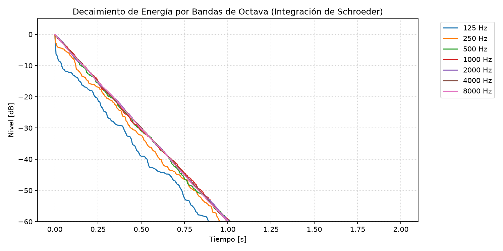
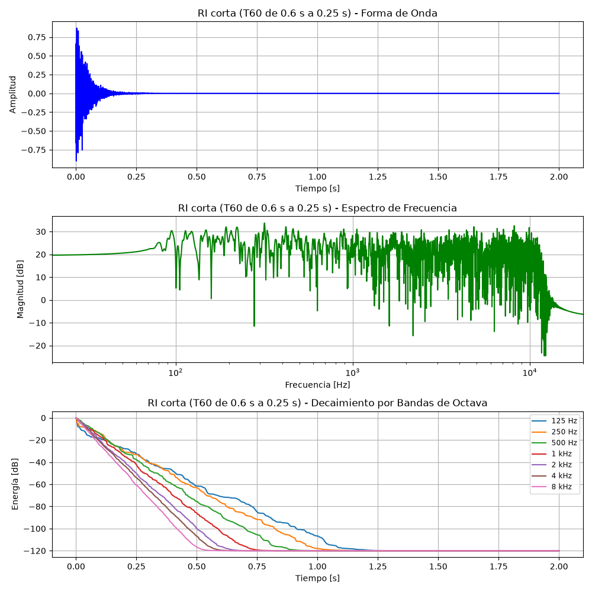

# Evidencias de Validación — Milestone 2 (M2)

## 1. Ida y Vuelta Sintética (Deconvolución Espectral)
Se validó el método de deconvolución en el dominio de la frecuencia (`get_impulse_response`) mediante la prueba completa de ida y vuelta:
1. Generación de una RI sintética ($T_{60} = 1.0\text{ s}$).
2. Convolución con un *sine sweep* logarítmico (3 segundos, 20 Hz – 20 kHz).
3. Deconvolución con el filtro inverso y alineación de pico.

* **Resultado:** Coeficiente de correlación de Pearson entre la RI original (alineada en su pico) y la recuperada: **`0.99999`** (objetivo > 0.99).

---

## 2. Filtrado por Bandas de Octava (IEC 61260)
Se implementó `filter_single_band` aplicando filtros Butterworth de orden 4 con `sosfiltfilt` para filtrado de fase cero.

---

## 3. Análisis de Respuestas al Impulso (RIRs Sintéticas Controladas)

Para la evaluación del comportamiento temporal, espectral y de decaimiento por octavas en esta etapa (M2), se utilizaron respuestas al impulso sintéticas generadas algorítmicamente (`generate_synthetic_ir`), lo que permite un control preciso y reproducible de los tiempos de reverberación objetivo ($T_{60}$):

### A. RIR Sintética Corta ($T_{60} \approx 0.4\text{ s}$ — Recinto Pequeño / Estudio)
Respuesta al impulso representativa de un espacio con baja reverberación. Se evalúan 3 paneles:
1. **Forma de onda:** Decaimiento temporal rápido y limpio.
2. **Espectro de frecuencia:** Respuesta plana sin vacíos pronunciados.
3. **Decaimiento por bandas de octava:** Curvas de Schroeder paralelas trazadas para las 8 bandas estándar (125 Hz a 8 kHz).

### B. RIR Sintética Larga ($T_{60} \approx 2.0\text{ s}$ — Sala Reverberante / Aula Magna)
Respuesta al impulso representativa de un espacio altamente reverberante.
1. **Forma de onda:** Envolvente de decaimiento prolongado.