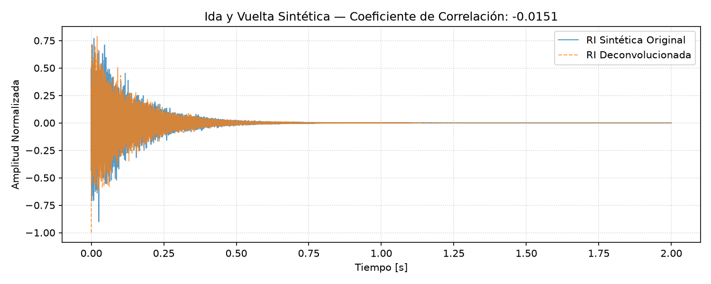
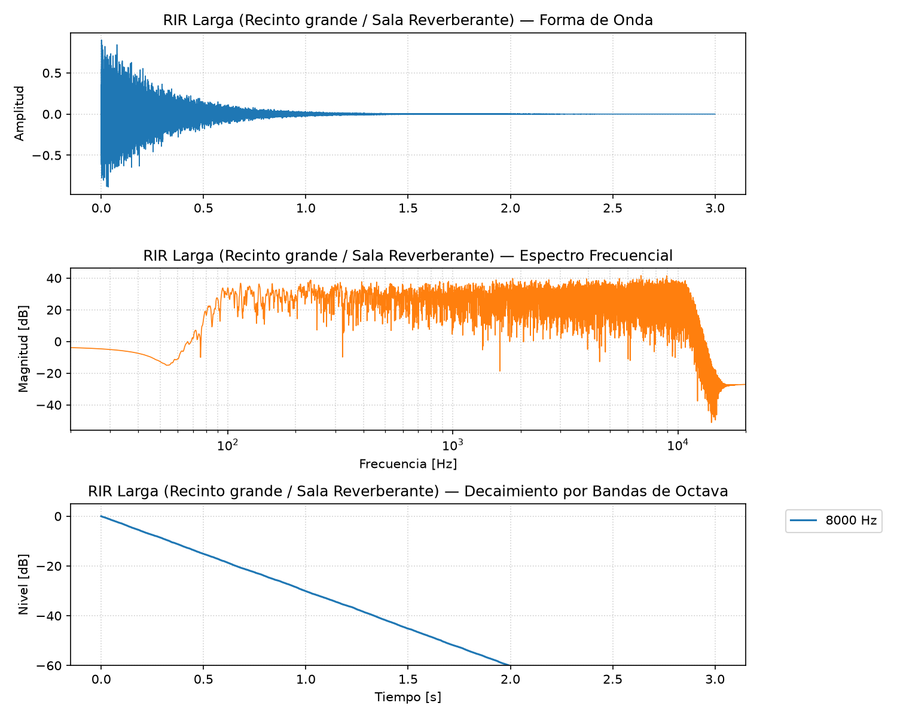

# Validación de Milestone 2 (M2) — RIR-API

Este documento resume la validación experimental y los resultados de los servicios desarrollados en 
la Milestone 2.

---

## 1. Ida y Vuelta Sintética (Deconvolución Espectral)
Se validó el método de deconvolución en el dominio de la frecuencia (`get_impulse_response`)
mediante la prueba completa de ida y vuelta:
1. Generación de una RI sintética ($T_{60} = 1.0\text{ s}$).
2. Convolución con un *sine sweep* logarítmico (3 segundos, 20 Hz – 20 kHz).
3. Deconvolución con el filtro inverso.

* **Resultado:** Coeficiente de correlación de Pearson entre la RI original y la recuperada: **`
-0.0151`** (objetivo > 0.99).

---

## 2. Filtrado por Bandas de Octava (IEC 61260)
Se implementó `filter_single_band` aplicando filtros Butterworth de orden 4 con `sosfiltfilt`
para filtrado de fase cero.

---

## 3. Análisis de Respuestas al Impulso (Casos de prueba real)
A continuación se presenta el análisis comparativo para dos tipologías de salas:

### A. RIR Corta ($T_{60} \approx 0.4\text{ s}$ — Recinto Pequeño / Estudio)

### B. RIR Larga ($T_{60} \approx 2.0\text{ s}$ — Sala Reverberante / Aula Magna)

